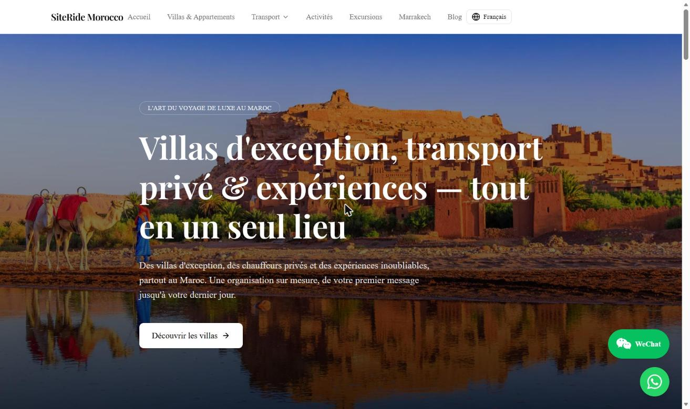

# SiteRide Morocco

🔗 **[https://siteridemorocco.com](https://siteridemorocco.com)**



## Aperçu

SiteRide Morocco est une plateforme touristique dédiée à Marrakech. Les visiteurs y
trouvent des hébergements, des solutions de transport, des activités et des excursions,
ainsi qu'un blog et des guides de lieux pour préparer leur séjour.
Le site est disponible en 6 langues, dont l'arabe avec une mise en page de droite à gauche (RTL).

## Stack technique

| Domaine            | Technologies                                              |
| ------------------ | --------------------------------------------------------- |
| Framework          | Next.js 16 (App Router), React 19, TypeScript             |
| Style & UI         | Tailwind CSS 4, shadcn/ui, Base UI, Lucide Icons          |
| Animations         | Framer Motion                                             |
| Internationalisation | next-intl (6 langues, support RTL)                      |
| Validation         | Zod                                                       |
| Images             | next/image + sharp (AVIF / WebP)                          |
| Intégrations       | Intégrations tierces (stockage média, authentification)   |

**Rendu :** App Router avec rendu côté serveur (SSR) pour les pages de contenu
dynamique, combiné à un cache de données côté serveur invalidé à la demande lors des
mises à jour. Les pages statiques sont pré-rendues au build.

## Architecture & déploiement

```
Next.js (build standalone) → Docker → Railway → Cloudflare (DNS · CDN · SSL) → Utilisateur
```

- **Docker** : image multi-étapes (dépendances → build → runtime), sortie `standalone`
  de Next.js pour une image légère, exécution sous un utilisateur non-root.
- **Railway** : hébergement du conteneur et déploiement continu.
- **Cloudflare** : DNS, CDN et certificat SSL devant l'application.
- **Sécurité** : en-têtes HTTP stricts (Content-Security-Policy, HSTS, X-Frame-Options,
  Referrer-Policy, Permissions-Policy) et un seul hôte canonique.

## SEO & GEO

- **Sitemap dynamique** avec alternatives par langue (hreflang, `x-default`) et `lastmod`.
- **robots.txt** généré, excluant les espaces privés.
- **Métadonnées par page** générées dynamiquement : titre, description, URL canonique,
  balises Open Graph et Twitter Cards.
- **Données structurées JSON-LD** (schema.org) : Organization / TravelAgency, WebSite,
  BreadcrumbList, Product / Offer, AggregateRating, Article, FAQPage.
- **Multilingue** : URL localisées pour 6 langues, balises `hreflang`, attribut `dir` RTL.
- **GEO (Generative Engine Optimization)** : fichier `llms.txt` généré dynamiquement
  pour exposer le contenu du site aux moteurs de réponse basés sur des LLM.
- **Pérennité des URL** : redirections 301 pour préserver les pages déjà indexées.

## Performance

- Images optimisées via `next/image` : formats AVIF / WebP, tailles adaptatives,
  chargement différé (lazy loading) natif.
- Polices auto-hébergées et optimisées avec `next/font`.
- Cache de données côté serveur avec revalidation ciblée après chaque modification.
- Import optimisé des bibliothèques d'icônes pour réduire la taille des bundles.
- Build `standalone` pour un démarrage rapide du conteneur.

## Compétences démontrées

- Développement full-stack moderne avec Next.js 16, React 19 et TypeScript
- Conception d'un site multilingue (6 langues, dont RTL)
- SEO technique avancé : données structurées, hreflang, sitemap, URL canoniques
- GEO : préparation du contenu pour les moteurs de recherche génératifs
- Conteneurisation (Docker) et déploiement cloud (Railway, Cloudflare)
- Sécurité web (CSP, HSTS, en-têtes HTTP)
- Optimisation des performances et stratégie de cache
- Gestion d'un produit en production, de la conception à la mise en ligne

## Note

Projet commercial en production : le code source est privé.
